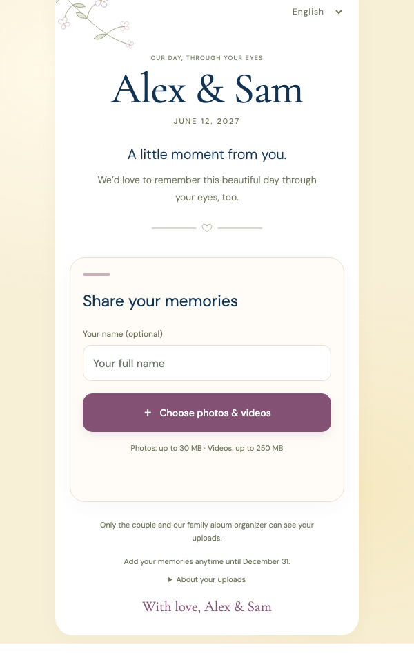

# Wedding Photo Uploader

A private, mobile-first page where wedding guests upload their original photos and videos straight into the couple's Google Drive. There is no app to install and no sign-up: guests scan a QR code on their table, optionally type their name, and pick files.

<p align="center"></p>

- **Guest-friendly:** resumable 4 MiB chunked uploads that survive flaky venue Wi-Fi, clear progress, and retry for failed files.
  - Built-in copy in English, Türkçe, Deutsch, Español, Français and Italiano. Guests see their phone's language automatically.
- **Private by design:**
  - Access by invitation link or QR code plus Cloudflare Turnstile.
  - No public gallery.
  - Files land in a private Drive folder per guest, and the app never changes Drive sharing.
- **Safe with untrusted files:** every upload is checked by a separate validator that runs sandboxed by systemd with no network or credentials. Only JPG, PNG, WebP, HEIC/HEIF, MP4, MOV and M4V are accepted, and originals are stored byte-for-byte.
- **Small footprint:** FastAPI, SQLite and plain browser JavaScript. It runs on a 1 vCPU / 1 GiB VPS behind nginx and Cloudflare, with no Node, Redis or Docker at runtime.
- **Bounded:** upload budgets per file, session and event, disk-space floors, rate limits, a closing time, and an emergency stop.
- **Printable QR cards:** an A6 table card and an A4 entrance sign generated from your settings.

## How it works

```
phone ──HTTPS──▶ Cloudflare ──▶ nginx ──▶ API (FastAPI, 1 process) ──▶ SQLite queue + local temp files
                                                                              │
                                    Google Drive ◀── worker ◀── validator (systemd sandbox, no network)
```

1. The invitation token in the URL fragment and a Turnstile proof are exchanged for an HttpOnly session.
2. The API reserves space for the declared size up front, then accepts exact-offset chunks.
3. The worker has each finished file validated in the sandbox.
4. The worker uploads the original to Drive resumably, checks Drive's size and MD5, and deletes the local copy.

The page says "Saved" only after Drive confirms the file. [docs/SECURITY.md](docs/SECURITY.md) covers the threat model and limits.

## Quick start (local)

Needs [uv](https://docs.astral.sh/uv/) and, for video checks, `ffmpeg`.

```bash
uv sync
uv run pytest -q
node --test tests/test_turnstile.cjs   # optional; Node is only used for tests
uv run python scripts/browser_fixture.py
```

Open http://127.0.0.1:8766/__test_entry and upload `tmp/browser-test/sample.jpg`. The fixture uses the real API and validator but a fake Drive that writes into `tmp/`. It's for local testing only; never deploy it.

## Deploying for your event

Follow [docs/INSTALL.md](docs/INSTALL.md). It covers the Google Drive authorization, the Ubuntu server, Cloudflare/Turnstile/TLS, a rehearsal checklist, QR cards, and event-day operations. In short:

1. Copy `.env.example` to `.env` and describe your event.
2. Run `python -m app.manage authorize` once on your laptop to connect Drive.
3. On the server, run `deploy/prepare-server.sh` → `install-systemd-validator.sh` → `install-drive.py` → `install-web.sh <domain>`.
4. Rehearse with real phones, print the cards, and turn on `UPLOADS_ENABLED` for the event.

## Configuration

All settings live in `.env` (see [.env.example](.env.example)).

| Variable | Default | Purpose |
|---|---|---|
| `EVENT_TITLE` | `Alex & Sam` | Names shown on the page, cards and OAuth pages |
| `EVENT_MONOGRAM` | `A&S` | Short monogram for the top bar |
| `EVENT_DATE` | `2027-06-12` | ISO date; each language formats it |
| `CLOSE_AT` | `2027-06-20T00:00:00+00:00` | Uploads close at this instant; timezone offset required |
| `DEFAULT_LANG` | `en` | Used when the guest's browser language isn't offered |
| `LANGUAGES` | `en,tr,de,es,fr,it` | Languages in the picker; each needs `app/static/locales/<code>.json` |
| `EVENT_SLUG` | empty | Optional readable path such as `/alex-sam-120627` for typed entry. Still requires Turnstile; not a secret |
| `CONTACT_EMAIL` | empty | Shown to guests for questions and deletion requests |
| `PRIVACY_URL` | empty | HTTPS link to your privacy policy; hidden when empty |
| `DRIVE_FOLDER_NAME` | `EVENT_TITLE · EVENT_DATE` | Name of the album folder created at authorization |
| `ANONYMOUS_GUEST_LABEL` | `Guest` | Folder name for guests who leave the name blank |
| `PUBLIC_ORIGIN` | `https://photos.example.com` | Exact public origin; requests for other hosts are refused |
| `UPLOADS_ENABLED` | `false` | Master switch and emergency stop |
| `DEV_MODE` | `false` | Local HTTP on localhost only |
| `TEMP_BUDGET_BYTES` | `3000000000` | Disk reserved for files not yet confirmed by Drive |
| `MIN_FREE_BYTES` | `2000000000` | Refuse new uploads below this free disk space |
| `EVENT_BUDGET_BYTES` | `100000000000` | Total bytes admitted for the whole event |
| `INVITE_HASH`, `TURNSTILE_*`, `GOOGLE_TOKEN_FILE`, `DRIVE_ROOT_ID` | — | Written by the setup commands; never commit |

Fixed limits: 30 MB per photo, 250 MB per video, 30 files per selection, and 2 GB / 500 attempts per guest session.

## Adding or editing a language

Copy `app/static/locales/en.json` to `<code>.json` (an ISO 639 code such as `pt` or `nl`), translate the values, keep the `{title}`, `{date}`, `{deadline}`, `{count}`, `{name}` and `{email}` placeholders, and add the code to `LANGUAGES`. `tests/test_event_config.py` checks that every locale has the same keys and placeholders. The German, Spanish, French and Italian copy would benefit from a native speaker's review; pull requests are welcome.

To restyle the page, edit the colour tokens in `app/static/theme.css`.

## Limitations

- One API process by design; the chunk locks are in-process.
- No antivirus or content moderation. Validation isn't sanitization, so review the album privately in Drive.
- Mobile browsers may pause uploads in background tabs, so guests are asked to keep the page open. This isn't an offline or background-upload PWA.
- A disk failure before Drive confirms a file can lose it. Guests keep their originals.

## License

[MIT](LICENSE). Bundled fonts (DM Sans, Cormorant Garamond) are under the SIL Open Font License; see [NOTICE](NOTICE).
